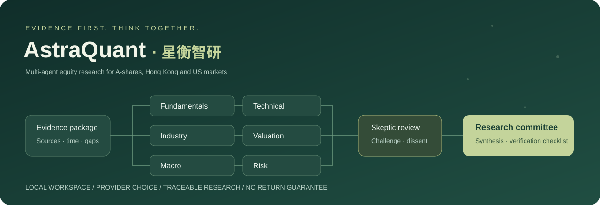
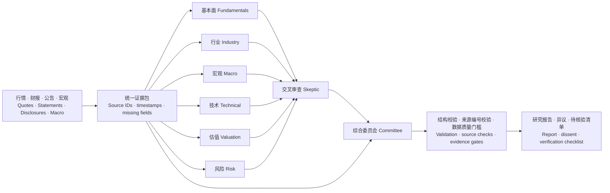
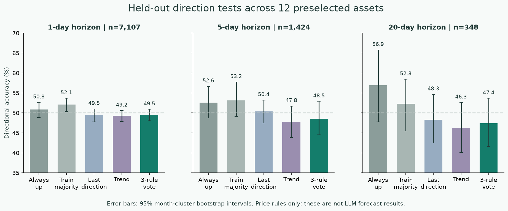
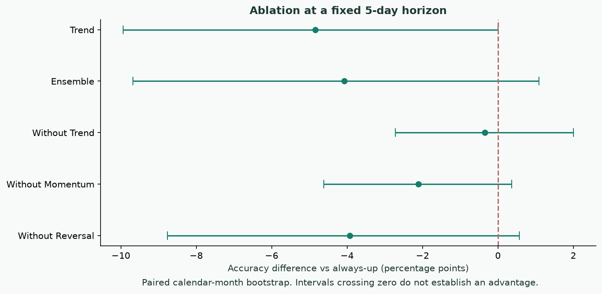
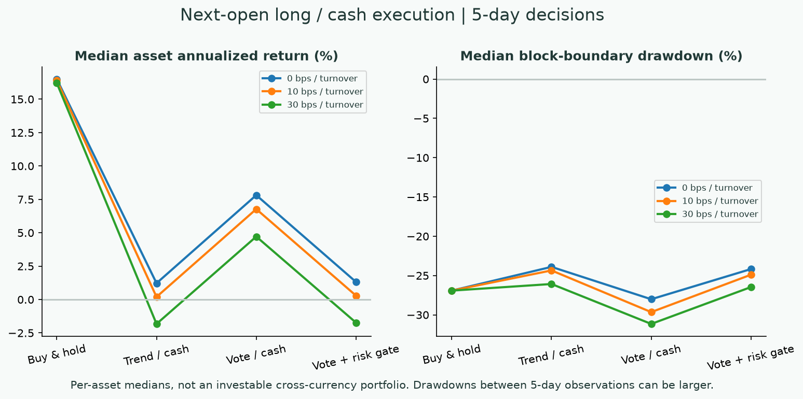
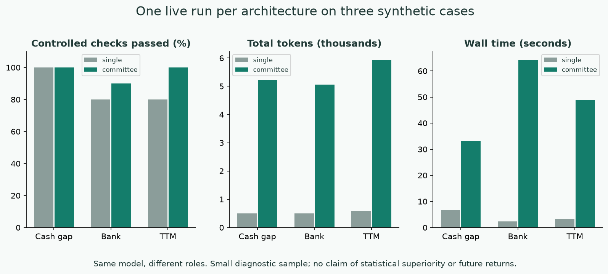
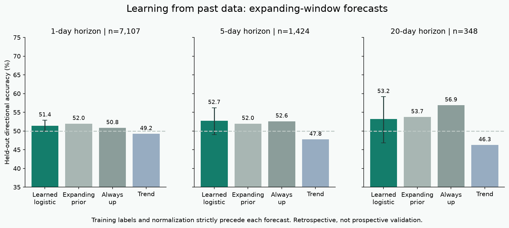

# AstraQuant · 星衡智研

### Evidence-first multi-agent equity research｜以证据为核心的多 Agent 股票研究工作站



[中文 / English](#为什么是多-agentwhy-multiple-agents) · [部署 Deployment](docs/DEPLOYMENT.md) · [API 配置 Providers](docs/PROVIDERS.md) · [实验 Experiments](docs/EXPERIMENTS.md) · [功能说明 Features](docs/FEATURES.zh-CN.md)

**把公司、行业、宏观、量价、估值与风险放到同一张研究桌上，再让审查员提出反对意见。**

**Put fundamentals, industry, macro, price action, valuation and risk at one research table—then ask a skeptic to challenge the conclusions.**

AstraQuant 是面向 **A 股、港股、美股**的本地股票研究应用：八角色研究链路、可追溯证据、专业行情图表、大盘星图、全景数据中心、自选与持仓、估值及回测。前端和 SQLite 数据库在本机运行；云端模型接收研究证据。也可使用本机 Ollama 模型。

AstraQuant is a local equity research application for **mainland China, Hong Kong and US markets**. It combines an eight-role research workflow, traceable evidence, interactive charts, market constellations, a panoramic data center, watchlists, holdings, valuation and backtesting. The UI and SQLite database run locally; cloud providers receive research evidence. Local Ollama inference is also supported.

> **研究状态 / Research status:** 已提供方向信号实验，但尚未证明稳定预测优势或超额收益。价格规则实验与八角色 LLM 报告分别评估。 / Directional experiments are included; stable predictive advantage or excess returns have not been demonstrated. Price-rule experiments and eight-role LLM reports are evaluated separately.

## 为什么是多 Agent｜Why multiple agents

| 角色 Role | 负责的问题 Research responsibility |
| --- | --- |
| 基本面 Fundamentals | 三大报表、盈利质量、TTM、现金流、财务健康 / Statements, earnings quality, TTM, cash flow and balance-sheet health |
| 行业 Industry | 商业模式、竞争壁垒、同业与周期 / Business model, moat, peers and industry cycle |
| 宏观 Macro | 经济、政策、利率汇率的传导与证据缺口 / Economic and policy transmission, rates, FX and missing evidence |
| 技术 Technical | 趋势、量价、波动与信号失效条件 / Trend, volume, volatility and invalidation conditions |
| 估值 Valuation | PE/PB/PEG 适用性、假设与情景 / Multiple applicability, assumptions and scenarios |
| 风险 Risk | 债务、治理、现金流背离与尾部风险 / Debt, governance, cash-flow divergence and tail risks |
| 交叉审查 Skeptic | 挑战冲突、错用口径和不受证据支持的结论 / Challenge contradictions, inconsistent definitions and unsupported claims |
| 综合委员会 Committee | 保留异议，形成证据约束下的研究优先级 / Preserve disagreement and synthesize evidence-constrained research priorities |



- **覆盖更清楚 / Explicit coverage:** 固定角色分工让财务、行业与风险问题分别进入流程，而不是依赖一次泛化回答。 / Assigned roles make financial, industry and risk questions explicit in the workflow.
- **异议可查看 / Inspectable disagreement:** 保留各角色输出，审查员和委员会顺序运行，用户能看到结论如何形成。 / Specialist outputs remain visible; sequential review and synthesis expose how conclusions form.
- **证据可追溯 / Traceable evidence:** 来源编号、抓取时间、缺失字段、失败角色和使用量随报告保存。 / Reports preserve source IDs, retrieval times, missing fields, failed roles and token usage.
- **模型可分工 / Model routing:** 可给风险、审查、综合等角色分别配置供应商与模型。 / Providers and models can be assigned per role.

默认是**同一个模型的八种角色提示与工作流**，不代表八个独立训练模型。结构与引用编号检查不能自动证明引用语义正确；更多角色也会增加耗时、费用和错误传播的机会。当前小样本实测没有证明多角色优于单次回答。

By default, this is **one model used in eight prompted roles**, not eight independently trained models. Schema and source-ID checks do not prove semantic correctness. More roles add latency, cost and opportunities to propagate errors. The current small diagnostic sample does not demonstrate superiority over a single call.

## 核心功能｜Capabilities

| 工作区 Workspace | 功能 Features |
| --- | --- |
| 研究工作台 Research | 八角色、六种风格、纯数据模式、补充证据、取消、追问、历史与导出 / Eight roles, six styles, data-only mode, supplied evidence, cancellation, follow-up, history and exports |
| 行情 Charts | 分时/五日/分钟/日/周/月 K，MA/BOLL/MACD/RSI/KDJ，成交量额、五档快照 / Intraday, five-day, minute, daily, weekly and monthly charts, indicators, volume/value and order-book snapshots |
| 资金流 Capital flow | A 股数据商大单/超大单买卖额与净额；分时与日序列 / A-share vendor-classified large-order buy/sell/net value, intraday and daily series |
| 大盘星图 Constellation | 行业聚类、热力、涨跌散点、成交额/市值权重、缩放和筛选 / Industry clusters, heatmaps, return scatterplots, turnover/cap weights, zoom and filtering |
| 数据中心 Data center | 市场、指数、行业、概念、资金、估值、个股、来源八类全景 / Eight views covering markets, indices, industries, themes, flows, valuations, securities and sources |
| 自选/持仓 Watchlists/holdings | 透明规则筛选、本币估值、集中度与风险项 / Transparent screening, currency-separated values, concentration and risk flags |
| 回测/DCF Backtest/DCF | 延迟成交、成本与持有基准；FCFF/WACC 与敏感性分析 / Delayed execution, costs and buy-and-hold baseline; FCFF/WACC and sensitivity analysis |

市场全景覆盖证券柜台，港美列表可能含 ETF、票据及不同币种柜台，不能把行数当作独立公司数。“主力”是数据商成交分类，不是真实机构身份；港美同口径资金数据不可用时会明确显示缺失。

Panoramas cover security listings/counters; overseas lists may include ETFs, notes and multiple currency counters. Row counts are not unique-company counts. “Main-force” flow is a vendor order-size classification, not verified institutional identity. Unsupported overseas flows remain explicitly unavailable.

## 实验与图表｜Experiments and charts

可复现实验包含 **12 标的方向测试、历史数据训练与向前预测、信号消融、成本/风险分析、单次回答与八角色协作的受控证据审计**。规则参数与样本池写入脚本，测试段约为 2024 年 4–5 月至 2026-10-14，各市场交易日不同。未完成的当日 K 线被排除。

Reproducible experiments include **12-asset direction tests, expanding-window learned forecasts, signal ablation, cost/risk analysis, and controlled evidence audits comparing one call with eight roles**. The universe and rules are fixed in source. Held-out observations span approximately April–May 2024 through 2026-10-14, depending on the market. Current-day bars are excluded.



| 预测跨度 Horizon | 有效样本 N | 三规则投票 Three-rule vote | 始终看涨 Always up |
| --- | ---: | ---: | ---: |
| 1 日 / day | 7,107 | 49.50% | 50.84% |
| 5 日 / days | 1,424 | 48.53% | 52.60% |
| 20 日 / days | 348 | 47.41% | 56.90% |

这些结果**不支持当前三规则投票具有稳定方向预测优势**。项目的可核验价值首先在证据整理、指标计算、分工审议与研究复核。是否能提升实际投资决策，需要更大的点时数据集、重复对照和前瞻跟踪。

These results **do not establish a stable directional advantage for the current three-rule vote**. The inspectable value is evidence organization, indicator calculation, structured review and research verification. Better investment decisions require larger point-in-time datasets, repeated controlled comparisons and prospective tracking.







补充的逻辑回归每 20 个交易日只用当时已知历史重新训练，1/5/20 日方向准确率为 **51.40% / 52.74% / 53.16%**。相对滚动历史上涨比例基准的配对区间均包含零，概率误差也没有改善。因此这些历史实验展示了可以生成和检验方向预测，仍未证明稳定预测优势。

The additional logistic model refits every 20 sessions using only history available then. Its 1/5/20-day directional accuracy is **51.40% / 52.74% / 53.16%**. Paired intervals against an expanding historical-prior baseline all include zero, and probability errors do not improve. The experiments demonstrate generating and testing forecasts, not a stable predictive advantage.

完整方法、实测数字、限制与复现命令见 [实验报告 / Experiment report](docs/EXPERIMENTS.md)。原始行情缓存保留在本地；仓库提供聚合结果与来源清单，不重新分发批量原始行情。

See the [experiment report](docs/EXPERIMENTS.md) for methods, measured results, limitations and reproduction commands. Raw quote caches stay local; the repository includes aggregate results and provenance rather than bulk vendor OHLC data.

## 快速部署｜Quick start

需要 **Node.js 24+**。运行服务无需 Python、前端构建或生产 npm 依赖。Python 仅用于重绘实验图表。

Requires **Node.js 24+**. Runtime needs no Python, frontend build step or production npm dependencies. Python is optional for rendering experiment charts.

```powershell
# Windows PowerShell
git clone https://github.com/13536309143/Stock.git
cd Stock
Copy-Item .env.example .env
# 编辑 .env：选择供应商、填写自己的 key 和可用模型 ID
# Edit .env: choose a provider and enter your own key/model ID
npm.cmd start
```

```bash
# macOS / Linux
git clone https://github.com/13536309143/Stock.git
cd Stock
cp .env.example .env
# Edit .env
npm start
```

打开 / Open **http://127.0.0.1:8787**。Windows 也可以双击 `启动股研助手.cmd` / `停止股研助手.cmd`。

```bash
# Docker Compose: .env must already exist
docker compose up -d --build
docker compose logs -f
```

容器仅映射到宿主机回环地址；持久化数据在命名卷中。完整安装、更新、备份、停止与排错见 [部署说明 / Deployment guide](docs/DEPLOYMENT.md)。

The container port is published to host loopback only; a named volume persists data. See the [deployment guide](docs/DEPLOYMENT.md) for setup, upgrades, backup, shutdown and troubleshooting.

## 主流模型 API｜Model providers

支持 MiniMax、OpenAI Responses、Anthropic Claude、Gemini、DeepSeek、通义千问、Kimi/Moonshot、智谱、硅基流动、OpenRouter、Groq、xAI、火山方舟、Azure OpenAI、Ollama 和自定义 OpenAI Chat 兼容网关。

Adapters cover MiniMax, OpenAI Responses, Anthropic Claude, Gemini, DeepSeek, Qwen, Kimi/Moonshot, Zhipu, SiliconFlow, OpenRouter, Groq, xAI, Volcengine Ark, Azure OpenAI, Ollama and custom OpenAI Chat-compatible gateways.

```dotenv
# MiniMax (default)
LLM_PROVIDER=minimax
MINIMAX_API_KEY=your_key_here
MINIMAX_MODEL=MiniMax-M3

# Example: use another provider for the skeptic role
# AGENT_SKEPTIC_PROVIDER=anthropic
# AGENT_SKEPTIC_MODEL=your_enabled_model_id
# ANTHROPIC_API_KEY=your_anthropic_key
```

供应商使用各自密钥；切换供应商不会复用 MiniMax 密钥。MiniMax 已用真实凭据测试；其他适配器完成协议模拟测试，仍需用对应账号实测。[配置示例与官方文档 / Configuration and official references](docs/PROVIDERS.md)。

Each provider uses its own credential; changing providers never reuses the MiniMax key. MiniMax has been exercised with live credentials. Other adapters have protocol-mock coverage and still need account-specific live validation. [Configuration examples and official references](docs/PROVIDERS.md).

## 开发与复现｜Development and reproduction

```bash
npm ci --ignore-scripts
npm run check
npm test
npm run release:check
npm run experiments              # Public market requests; no LLM charges
npm run experiment:llm           # Paid LLM calls using your configured providers
python -m pip install -r experiments/requirements.txt
python experiments/plot.py
python experiments/learned.py     # Train on past data and forecast forward
```

```text
server.mjs             Local HTTP API and request protection
lib/providers.mjs      Provider isolation and native protocol adapters
lib/agents.mjs         Six specialists → skeptic → committee
lib/data.mjs           Evidence collection and provenance
lib/analytics.mjs      Financial/technical metrics, DCF, backtest
lib/market.mjs         Multi-period OHLC and capital flows
lib/panorama*.mjs      Full-market snapshots and sector views
lib/forecast.mjs       Separate deterministic price-rule experiment
public/               Browser UI, canvas charts and constellation
experiments/           Reproduction scripts and aggregate results
docs/                 Bilingual deployment, providers and experiments
tests/                Offline correctness, frontend and protocol tests
data/                 Private SQLite, reports and caches (ignored)
```

## 数据与边界｜Data and boundaries

- 财务/行情使用公开数据商接口，可能延迟、限流、变更或中断；港美覆盖不等同 A 股。 / Public vendor endpoints may be delayed, throttled, changed or unavailable; overseas coverage differs from A-shares.
- 持仓数量/成本留在本地；当前股票证据、研究偏好、补充资料与追问会发送给所选模型供应商。MiniMax 搜索另用其密钥。 / Holdings quantities/costs stay local. Security evidence, preferences, supplied notes and follow-up questions go to selected model providers. MiniMax search uses a separate provider credential.
- 研究等级、规则分数和证据信心都不是上涨概率；无自动交易、无收益承诺。 / Research priority, rule scores and evidence confidence are not probabilities of price appreciation. There is no automated trading or return guarantee.
- 本地应用尚无多用户身份认证，请保持回环访问，远程使用见部署文档中的 SSH 隧道。 / This local app has no multi-user authentication. Keep loopback binding; use the documented SSH tunnel for remote access.
- 源码发布不授予行情、搜索服务、第三方模型或评级数据的授权；使用须遵守各自条款。本仓库尚未指定源码开源许可证。 / Publication grants no rights to vendor quotes, search services, third-party models or ratings. Their terms apply. A source-code open-source license has not yet been selected.

项目 / Project: [13536309143/Stock](https://github.com/13536309143/Stock)
