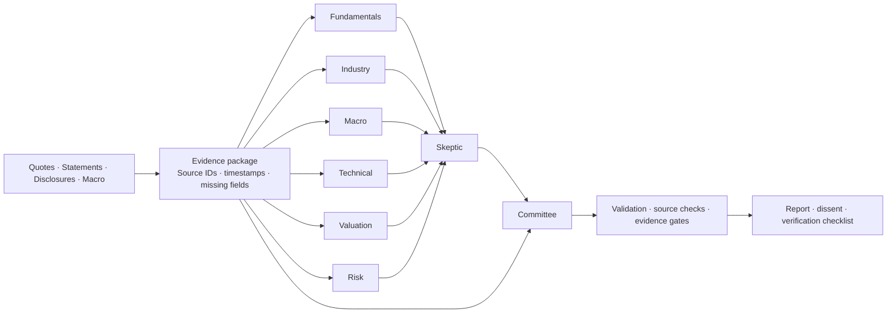

# AstraQuant

**English** | [简体中文](README.zh-CN.md)

### Evidence-first multi-agent equity research


[Documentation](docs/README.md) · [Features](docs/FEATURES.md) · [Deployment](docs/DEPLOYMENT.md) · [Model providers](docs/PROVIDERS.md) · [Experiments](docs/EXPERIMENTS.md) · [HTTP API](docs/API.md)

**Put fundamentals, industry, macro, price action, valuation and risk at one research table—then ask a skeptic to challenge the conclusions.**

AstraQuant is a local equity research application for **mainland China, Hong Kong and US markets**. It combines an eight-role research workflow, traceable evidence, interactive charts, market constellations, a panoramic data center, watchlists, holdings, valuation and backtesting. The UI and SQLite database run locally; cloud providers receive research evidence. Local Ollama inference is also supported.

> **Research status:** Directional experiments are included; stable predictive advantage or excess returns have not been demonstrated. Price-rule experiments and eight-role LLM reports are evaluated separately.

## Why multiple agents

| Role | Research responsibility |
| --- | --- |
| Fundamentals | Statements, earnings quality, TTM, cash flow and balance-sheet health |
| Industry | Business model, moat, peers and industry cycle |
| Macro | Economic and policy transmission, rates, FX and missing evidence |
| Technical | Trend, volume, volatility and invalidation conditions |
| Valuation | Multiple applicability, assumptions and scenarios |
| Risk | Debt, governance, cash-flow divergence and tail risks |
| Skeptic | Challenge contradictions, inconsistent definitions and unsupported claims |
| Committee | Preserve disagreement and synthesize evidence-constrained research priorities |



- **Explicit coverage:** Assigned roles make financial, industry and risk questions explicit in the workflow.
- **Inspectable disagreement:** Specialist outputs remain visible; sequential review and synthesis expose how conclusions form.
- **Traceable evidence:** Reports preserve source IDs, retrieval times, missing fields, failed roles and token usage.
- **Model routing:** Providers and models can be assigned per role.

By default, this is **one model used in eight prompted roles**, not eight independently trained models. Schema and source-ID checks do not prove semantic correctness. More roles add latency, cost and opportunities to propagate errors. The current small diagnostic sample does not demonstrate superiority over a single call.

## Capabilities

| Workspace | Features |
| --- | --- |
| Research | Eight roles, six styles, data-only mode, supplied evidence, cancellation, follow-up, history and exports |
| Charts | Intraday, five-day, minute, daily, weekly and monthly charts, indicators, volume/value and order-book snapshots |
| Capital flow | A-share vendor-classified large-order buy/sell/net value, intraday and daily series |
| Constellation | Industry clusters, heatmaps, return scatterplots, turnover/cap weights, zoom and filtering |
| Data center | Eight views covering markets, indices, industries, themes, flows, valuations, securities and sources |
| Watchlists/holdings | Transparent screening, currency-separated values, concentration and risk flags |
| Backtest/DCF | Delayed execution, costs and buy-and-hold baseline; FCFF/WACC and sensitivity analysis |

Panoramas cover security listings/counters; overseas lists may include ETFs, notes and multiple currency counters. Row counts are not unique-company counts. “Main-force” flow is a vendor order-size classification, not verified institutional identity. Unsupported overseas flows remain explicitly unavailable.

## Experiments and charts

Reproducible experiments include **12-asset direction tests, expanding-window learned forecasts, signal ablation, cost/risk analysis, and controlled evidence audits comparing one call with eight roles**. The universe and rules are fixed in source. Held-out observations span approximately April–May 2024 through 2026-10-14, depending on the market. Current-day bars are excluded.


| Horizon | Observations | Three-rule vote | Always up |
| --- | ---: | ---: | ---: |
| 1 day | 7,107 | 49.50% | 50.84% |
| 5 days | 1,424 | 48.53% | 52.60% |
| 20 days | 348 | 47.41% | 56.90% |

These results **do not establish a stable directional advantage for the current three-rule vote**. The inspectable value is evidence organization, indicator calculation, structured review and research verification. Better investment decisions require larger point-in-time datasets, repeated controlled comparisons and prospective tracking.


The additional logistic model refits every 20 sessions using only history available then. Its 1/5/20-day directional accuracy is **51.40% / 52.74% / 53.16%**. Paired intervals against an expanding historical-prior baseline all include zero, and probability errors do not improve. The experiments demonstrate generating and testing forecasts, not a stable predictive advantage.

See the [experiment report](docs/EXPERIMENTS.md) for methods, measured results, limitations and reproduction commands. Raw quote caches stay local; the repository includes aggregate results and provenance rather than bulk vendor OHLC data.

## Quick start

Requires **Node.js 24+**. Runtime needs no Python, frontend build step or production npm dependencies. Python is used for optional learned experiments and chart rendering.

```powershell
# Windows PowerShell
git clone https://github.com/13536309143/AstraQuant.git
cd AstraQuant
Copy-Item .env.example .env
# Edit .env: choose a provider and enter your own key/model ID
npm.cmd start
```

```bash
# macOS / Linux
git clone https://github.com/13536309143/AstraQuant.git
cd AstraQuant
cp .env.example .env
# Edit .env
npm start
```

Open **http://127.0.0.1:8787**. On Windows, the bundled `.cmd` launchers can also start/stop the background service. See the deployment guide for PowerShell launcher commands.

```bash
# Docker Compose: .env must already exist
docker compose up -d --build
docker compose logs -f
```


The container port is published to host loopback only; a named volume persists data. See the [deployment guide](docs/DEPLOYMENT.md) for setup, upgrades, backup, shutdown and troubleshooting.

## Model providers

Adapters cover MiniMax, OpenAI Responses, Anthropic Claude, Gemini, DeepSeek, Qwen, Kimi/Moonshot, Zhipu, SiliconFlow, OpenRouter, Groq, xAI, Volcengine Ark, Azure OpenAI, Ollama and custom OpenAI Chat-compatible gateways.

```dotenv
# MiniMax (default)
LLM_PROVIDER=minimax
MINIMAX_API_KEY=your_key_here
MINIMAX_MODEL=MiniMax-M3

# Example: use another provider for the skeptic role
# AGENT_SKEPTIC_PROVIDER=anthropic
# AGENT_SKEPTIC_MODEL=your_enabled_model_id
# ANTHROPIC_API_KEY=your_anthropic_key
```


Each provider uses its own credential; changing providers never reuses the MiniMax key. MiniMax has been exercised with live credentials. Other adapters have protocol-mock coverage and still need account-specific live validation. [Configuration examples and official references](docs/PROVIDERS.md).

## Development and reproduction

```bash
npm ci --ignore-scripts
npm run check
npm test
npm run release:check
npm run experiments              # Public market requests; no LLM charges
npm run experiment:llm           # Paid LLM calls using your configured providers
python -m pip install -r experiments/requirements.txt
python experiments/plot.py
python experiments/learned.py     # Train on past data and forecast forward
```

```text
server.mjs             Local HTTP API and request protection
lib/providers.mjs      Provider isolation and native protocol adapters
lib/agents.mjs         Six specialists → skeptic → committee
lib/data.mjs           Evidence collection and provenance
lib/analytics.mjs      Financial/technical metrics, DCF, backtest
lib/market.mjs         Multi-period OHLC and capital flows
lib/panorama*.mjs      Full-market snapshots and sector views
lib/forecast.mjs       Separate deterministic price-rule experiment
public/               Browser UI, canvas charts and constellation
experiments/           Reproduction scripts and aggregate results
docs/                 Separate English and Simplified Chinese guides
tests/                Offline correctness, frontend and protocol tests
data/                 Private SQLite, reports and caches (ignored)
```

## Data and boundaries

- Public vendor endpoints may be delayed, throttled, changed or unavailable; overseas coverage differs from A-shares.
- Holdings quantities/costs stay local. Security evidence, preferences, supplied notes and follow-up questions go to selected model providers. MiniMax search uses a separate provider credential.
- Research priority, rule scores and evidence confidence are not probabilities of price appreciation. There is no automated trading or return guarantee.
- This local app has no multi-user authentication. Keep loopback binding; use the documented SSH tunnel for remote access.
- Publication grants no rights to vendor quotes, search services, third-party models or ratings. Their terms apply. A source-code open-source license has not yet been selected.

Project: [13536309143/AstraQuant](https://github.com/13536309143/AstraQuant)
