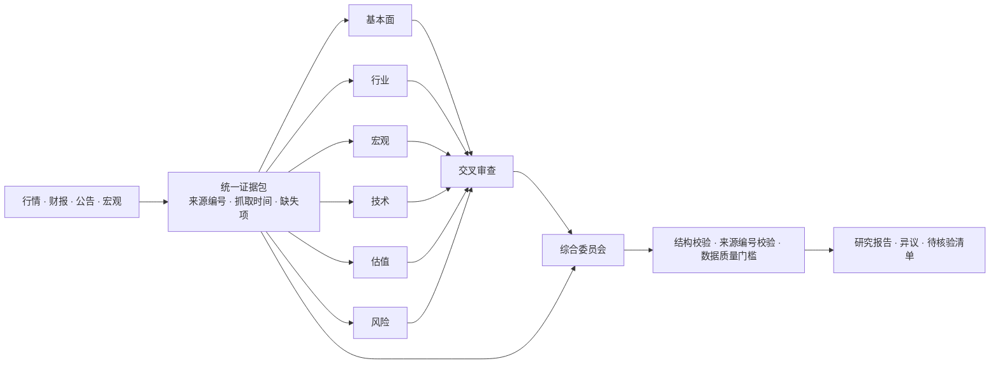

# AstraQuant · 星衡智研

[English](README.md) | **简体中文**

### 以证据为核心的多 Agent 股票研究工作站


[文档目录](docs/README.zh-CN.md) · [功能说明](docs/FEATURES.zh-CN.md) · [部署指南](docs/DEPLOYMENT.zh-CN.md) · [模型 API 配置](docs/PROVIDERS.zh-CN.md) · [实验报告](docs/EXPERIMENTS.zh-CN.md) · [本地 HTTP API](docs/API.zh-CN.md)

**把公司、行业、宏观、量价、估值与风险放到同一张研究桌上，再让审查员提出反对意见。**

AstraQuant 是面向 **A 股、港股、美股**的本地股票研究应用：八角色研究链路、可追溯证据、专业行情图表、大盘星图、全景数据中心、自选与持仓、估值及回测。前端和 SQLite 数据库在本机运行；云端模型接收研究证据。也可使用本机 Ollama 模型。

> **研究状态:** 已提供方向信号实验，但尚未证明稳定预测优势或超额收益。价格规则实验与八角色 LLM 报告分别评估。

## 为什么是多 Agent

| 角色 | 负责的问题 |
| --- | --- |
| 基本面 | 三大报表、盈利质量、TTM、现金流、财务健康 |
| 行业 | 商业模式、竞争壁垒、同业与周期 |
| 宏观 | 经济、政策、利率汇率的传导与证据缺口 |
| 技术 | 趋势、量价、波动与信号失效条件 |
| 估值 | PE/PB/PEG 适用性、假设与情景 |
| 风险 | 债务、治理、现金流背离与尾部风险 |
| 交叉审查 | 挑战冲突、错用口径和不受证据支持的结论 |
| 综合委员会 | 保留异议，形成证据约束下的研究优先级 |



- **覆盖更清楚:** 固定角色分工让财务、行业与风险问题分别进入流程，而不是依赖一次泛化回答。
- **异议可查看:** 保留各角色输出，审查员和委员会顺序运行，用户能看到结论如何形成。
- **证据可追溯:** 来源编号、抓取时间、缺失字段、失败角色和使用量随报告保存。
- **模型可分工:** 可给风险、审查、综合等角色分别配置供应商与模型。

默认是**同一个模型的八种角色提示与工作流**，不代表八个独立训练模型。结构与引用编号检查不能自动证明引用语义正确；更多角色也会增加耗时、费用和错误传播的机会。当前小样本实测没有证明多角色优于单次回答。

## 核心功能

| 工作区 | 功能 |
| --- | --- |
| 研究工作台 | 八角色、六种风格、纯数据模式、补充证据、取消、追问、历史与导出 |
| 行情 | 分时/五日/分钟/日/周/月 K，MA/BOLL/MACD/RSI/KDJ，成交量额、五档快照 |
| 资金流 | A 股数据商大单/超大单买卖额与净额；分时与日序列 |
| 大盘星图 | 行业聚类、热力、涨跌散点、成交额/市值权重、缩放和筛选 |
| 数据中心 | 市场、指数、行业、概念、资金、估值、个股、来源八类全景 |
| 自选与持仓 | 透明规则筛选、本币估值、集中度与风险项 |
| 回测与 DCF | 延迟成交、成本与持有基准；FCFF/WACC 与敏感性分析 |

市场全景覆盖证券柜台，港美列表可能含 ETF、票据及不同币种柜台，不能把行数当作独立公司数。“主力”是数据商成交分类，不是真实机构身份；港美同口径资金数据不可用时会明确显示缺失。

## 实验与图表

可复现实验包含 **12 标的方向测试、历史数据训练与向前预测、信号消融、成本/风险分析、单次回答与八角色协作的受控证据审计**。规则参数与样本池写入脚本，测试段约为 2024 年 4–5 月至 2026-10-14，各市场交易日不同。未完成的当日 K 线被排除。


| 预测跨度 | 有效样本 | 三规则投票 | 始终看涨 |
| --- | ---: | ---: | ---: |
| 1 日 | 7,107 | 49.50% | 50.84% |
| 5 日 | 1,424 | 48.53% | 52.60% |
| 20 日 | 348 | 47.41% | 56.90% |

这些结果**不支持当前三规则投票具有稳定方向预测优势**。项目的可核验价值首先在证据整理、指标计算、分工审议与研究复核。是否能提升实际投资决策，需要更大的点时数据集、重复对照和前瞻跟踪。


补充的逻辑回归每 20 个交易日只用当时已知历史重新训练，1/5/20 日方向准确率为 **51.40% / 52.74% / 53.16%**。相对滚动历史上涨比例基准的配对区间均包含零，概率误差也没有改善。因此这些历史实验展示了可以生成和检验方向预测，仍未证明稳定预测优势。

完整方法、实测数字、限制与复现命令见 [实验报告](docs/EXPERIMENTS.zh-CN.md)。原始行情缓存保留在本地；仓库提供聚合结果与来源清单，不重新分发批量原始行情。

## 快速部署

需要 **Node.js 24+**。运行服务无需 Python、前端构建或生产 npm 依赖。Python 仅用于可选的实验训练与绘图。

```powershell
# Windows PowerShell
git clone https://github.com/13536309143/AstraQuant.git
cd AstraQuant
Copy-Item .env.example .env
# 编辑 .env：选择供应商、填写自己的 key 和可用模型 ID
# 编辑 .env，选择供应商并填写自己的密钥和可用模型 ID
npm.cmd start
```

```bash
# macOS / Linux
git clone https://github.com/13536309143/AstraQuant.git
cd AstraQuant
cp .env.example .env
# 编辑 .env
npm start
```

打开 **http://127.0.0.1:8787**。Windows 也可以双击 `启动股研助手.cmd` / `停止股研助手.cmd`。

```bash
# Docker Compose：先配置 .env
docker compose up -d --build
docker compose logs -f
```

容器仅映射到宿主机回环地址；持久化数据在命名卷中。完整安装、更新、备份、停止与排错见 [部署指南](docs/DEPLOYMENT.zh-CN.md)。

## 主流模型 API

支持 MiniMax、OpenAI Responses、Anthropic Claude、Gemini、DeepSeek、通义千问、Kimi/Moonshot、智谱、硅基流动、OpenRouter、Groq、xAI、火山方舟、Azure OpenAI、Ollama 和自定义 OpenAI Chat 兼容网关。

```dotenv
# 默认使用 MiniMax
LLM_PROVIDER=minimax
MINIMAX_API_KEY=your_key_here
MINIMAX_MODEL=MiniMax-M3

# 可选：为交叉审查角色配置其他供应商
# AGENT_SKEPTIC_PROVIDER=anthropic
# AGENT_SKEPTIC_MODEL=your_enabled_model_id
# ANTHROPIC_API_KEY=your_anthropic_key
```

供应商使用各自密钥；切换供应商不会复用 MiniMax 密钥。MiniMax 已用真实凭据测试；其他适配器完成协议模拟测试，仍需用对应账号实测。见 [模型 API 配置](docs/PROVIDERS.zh-CN.md)。

## 开发与复现

```bash
npm ci --ignore-scripts
npm run check
npm test
npm run release:check
npm run experiments              # 公开行情请求，不调用收费模型
npm run experiment:llm           # 使用配置的收费模型进行实测
python -m pip install -r experiments/requirements.txt
python experiments/plot.py
python experiments/learned.py     # 使用历史数据训练并向前预测
```

```text
server.mjs             本地 HTTP API 与请求保护
lib/providers.mjs      供应商隔离与原生协议适配
lib/agents.mjs         六专业角色 → 审查 → 综合
lib/data.mjs           证据采集与来源记录
lib/analytics.mjs      财务/技术指标、DCF 与回测
lib/market.mjs         多周期行情与资金流
lib/panorama*.mjs      全市场快照与板块全景
lib/forecast.mjs       独立的确定性价格规则实验
public/               浏览器界面、图表与星图
experiments/           复现脚本与聚合结果
docs/                 独立的英文与中文部署、模型及实验文档
tests/                离线正确性、前端与协议验证
data/                 私人数据库、报告与缓存，不发布
```

## 数据与边界

- 财务/行情使用公开数据商接口，可能延迟、限流、变更或中断；港美覆盖不等同 A 股。
- 持仓数量/成本留在本地；当前股票证据、研究偏好、补充资料与追问会发送给所选模型供应商。MiniMax 搜索另用其密钥。
- 研究等级、规则分数和证据信心都不是上涨概率；无自动交易、无收益承诺。
- 本地应用尚无多用户身份认证，请保持回环访问，远程使用见部署文档中的 SSH 隧道。
- 源码发布不授予行情、搜索服务、第三方模型或评级数据的授权；使用须遵守各自条款。本仓库尚未指定源码开源许可证。

项目
