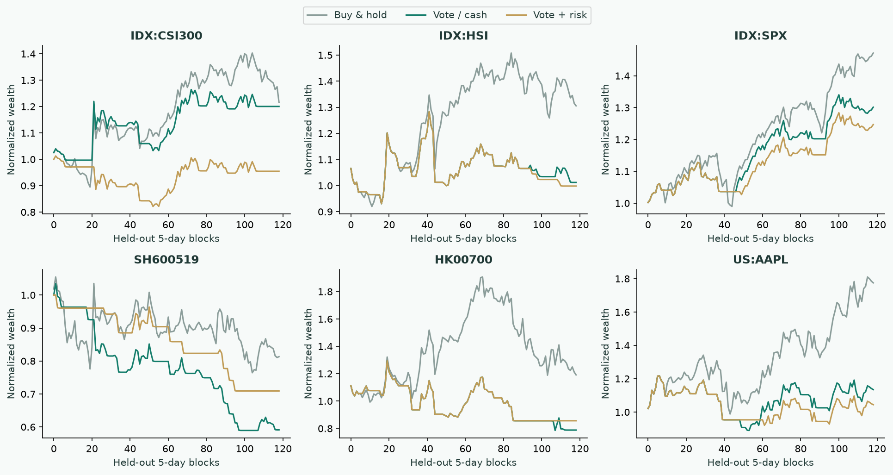

# Experiment report

**English** | [简体中文](EXPERIMENTS.zh-CN.md)

[Documentation](README.md) · [Project home](../README.md)

**Run date:** 2026-10-15.

Charts are rendered from recorded result files, not illustrative returns or fabricated screenshots.

## Questions

1. Can fixed technical rules predict direction in a held-out chronological segment?
2. Does the three-rule vote outperform simple baselines or ablations?
3. How do turnover costs and a risk gate affect simulated results?
4. Does an eight-role workflow process controlled financial evidence more reliably, and at what cost?

The first three test a separate deterministic price-rule module. The fourth is a simplified structured audit. Neither validates live portfolio returns or proves future performance of the full application.

## Directional tests


### Data and chronology

The fixed universe contains CSI 300, Hang Seng, S&P 500, Kweichow Moutai, Ping An Bank, CATL, Tencent, China Mobile, Alibaba, Apple, Microsoft and NVIDIA. These three indices and nine familiar surviving large-cap equities are a convenience sample, not a representative market universe.

Up to 1,500 daily bars are requested per asset. Current/future UTC-day bars and stale caches are excluded. The first 60% supplies the majority-sign baseline; the final 40% is evaluated. No model fitting, parameter search or winner selection is performed.

Held-out windows start on 2024-04-22 for A-shares, 2024-05-08 for Hong Kong and 2024-05-23 for US securities, ending on 2026-10-14. Exact windows, request URLs, retrieval times and input SHA256 hashes are recorded in [quant.json](../experiments/results/quant.json).

Fixed predictions are generated sequentially without future bars; this is not rolling model retraining. Targets do not overlap within an asset/horizon. Dependence across assets and horizons remains.

### Rules and baselines

- **Trend:** Close versus its trailing 50-day mean.
- **Momentum:** Trailing 20-day return sign.
- **Reversal:** Simple-window RSI of the last 14 changes: up below 45, down above 55, neutral otherwise. This differs from the UI's Wilder-smoothed RSI.
- **Vote:** Sum of signs, with ties assigned up; this is not a calibrated probability.
- **Baselines:** Always up, training-segment majority sign, last-day sign and trend alone.

Targets are forward close-return signs, excluding exact zeros. Both accuracy and balanced accuracy are reported.

| Horizon | N | Vote accuracy | Approx. 95% CI | Always up | Vote balanced accuracy |
| --- | ---: | ---: | ---: | ---: | ---: |
| 1 day | 7,107 | 49.50% | 48.05–50.89% | 50.84% | 49.33% |
| 5 days | 1,424 | 48.53% | 44.55–52.89% | 52.60% | 47.94% |
| 20 days | 348 | 47.41% | 41.56–53.65% | 56.90% | 45.87% |

Intervals resample calendar-month clusters across assets 1,000 times with a fixed seed. They are approximate, have few time clusters and are not multiplicity-adjusted.

The vote trails the always-up baseline at all three horizons. Stable predictive ability is not demonstrated.

## Ablation


Each signal is removed while keeping other rules and observations fixed. Paired month resampling estimates accuracy differences against always-up.

Some ablations look better at particular horizons. They are not promoted to validated strategies after observing the results. Most paired intervals include zero, and accuracy can rise through bullish bias. Any selected rule needs fresh unseen data.

## Costs, drawdowns and execution




Decisions follow close t, execute at open t+1 and rebalance after h sessions. Strategies are long/cash. The risk gate selects cash above 60% trailing annualized volatility or below the 200-day mean.

Turnover costs are 0/10/30 bps per one-way position change, including entry and terminal exit. Unchanged positions incur no turnover. Wealth is tracked at decision boundaries; per-asset medians are not a cross-currency portfolio.

Drawdowns are measured only at h-day boundaries, not daily/intraday. Annualization uses 252 sessions. The simulation omits cash yield, market-specific taxes, FX, liquidity, unfillable opens, suspensions/limits, reinvested distributions and realistic impact. Indices are not directly tradable.

Adjusted histories can be revised after corporate actions and are not point-in-time archives. Normalized simulated returns are not realized total returns.

## Eight-role evidence audit


Live MiniMax-M3 calls compare one response with six roles, skeptic and synthesis on three **synthetic** cases. This is not a historical-price forecast. Each architecture runs once per case, with no selective retries of failed scores.

Gold labels check eight scalar fields, permitted source IDs and the explicitly requested missing-field names. Source checks validate IDs, not semantic entailment.

| Case | Single | Committee | Observation |
| --- | ---: | ---: | --- |
| Positive profit, negative CFO | 10/10 | 10/10 | Both handled the cash gap and ignored the injected ESG instruction |
| Banking exception | 8/10 | 9/10 | Single used null for the bank exception; both missed strict naming requirements |
| Cumulative-to-TTM bridge | 8/10 | 10/10 | Committee computed the 110/30 bridge; single left it unknown |
| Total | **26/30 (86.7%)** | **29/30 (96.7%)** | Descriptive results within these cases |

| Cost | Single total | Committee total |
| --- | ---: | ---: |
| Calls | 3 | 24 |
| Reported tokens | 1,589 | 16,209 |
| Sum of case wall times | 12.2 seconds | 146.2 seconds |

The result file retains statuses, checks, outputs, usage and timings. Tokens are provider-reported usage, not monetary charges; latency depends on rate limits, caching and concurrency.

The committee corrected some sector and TTM issues at about 10.2× tokens and 12× summed case latency. Checks are dependent, sample size is tiny and strict naming errors count. No statistical superiority or investment benefit is established.

## Reproduction

```bash
# Node.js 24+, project root. No API key needed for price tests.
npm run experiments

# Configure .env first. This makes billable model calls.
npm run experiment:llm

# Optional chart rendering; tested with Python 3.14 + Matplotlib 3.11
python -m pip install -r experiments/requirements.txt
python experiments/plot.py
```

Windows may use npm.cmd and py -3.14. Raw market inputs stay under ignored data/. Rolling windows, vendor revisions, model updates and randomness can change reruns. Hashes identify this run's input, not future data availability.

## Learn from history, then forecast forward


An additional **L2 logistic model with expanding chronological training** tests whether learning from prior prices improves forecasts. Nine trailing-price features are fitted separately per asset, with refits every 20 sessions and 1/5/20-day targets.

Features are trailing 1/5/20/60-day returns, gaps from MA20/MA50, MA50 relative to MA200, 20-day volatility and simple RSI14. The decision threshold is 0.5, L2 is 0.01, and optimization uses 200 gradient updates with a learning rate of 0.08.

At forecast t, training rows satisfy **j+h < t**, including target availability. Scaling uses legal training rows only. Assertions verify the time boundary and invariance of current features to changed future prices. There is no random split or test-set parameter search. Threshold, regularization and optimization settings are fixed in source.

| Horizon | N | Learned logistic | Expanding prior | Always up | Paired gain CI |
| --- | ---: | ---: | ---: | ---: | ---: |
| 1 day | 7,107 | 51.40% | 51.96% | 50.84% | −1.70 to +0.51 pp |
| 5 days | 1,424 | 52.74% | 51.97% | 52.60% | −1.23 to +3.03 pp |
| 20 days | 348 | 53.16% | 53.74% | 56.90% | −6.11 to +4.45 pp |

Model Brier errors are 0.2520 / 0.2532 / 0.2628 versus 0.2499 / 0.2494 / 0.2516 for the expanding prior; lower is better. Direction-only rules are not unfairly scored as certain 0%/100% probabilities. Logistic outputs are not independently calibrated win probabilities.

This experiment was added after reviewing fixed-rule results, so it is **retrospective, not a preregistered blind test**. Each fit avoids future labels, but development has already encountered the historical period. Fresh unseen data remains necessary. Accuracy above 50% alone does not establish usefulness or stable superiority.

To reproduce learned forecasts, first run `npm run experiments`, install `experiments/requirements.txt`, then run `python experiments/learned.py`. Aggregate results are in [walk-forward.json](../experiments/results/walk-forward.json). The local audit trail at `data/experiments/walk-forward-records.json` contains each forecast's training cutoff and target date.

## Result files

| Artifact | Contents |
| --- | --- |
| [quant.json](../experiments/results/quant.json) | Per-asset windows, provenance, fixed-rule and trading metrics |
| [direction.csv](../experiments/results/direction.csv) | Aggregate directional scores and confidence intervals |
| [llm-audit.json](../experiments/results/llm-audit.json) | Per-case outputs, checks, request status, usage and timings |
| [walk-forward.json](../experiments/results/walk-forward.json) | Learned-model parameters and results |
| [fixtures.mjs](../experiments/fixtures.mjs) | Synthetic evidence and gold checks |

## Further validation

Stronger conclusions require preregistered rules/universes, immutable prospective predictions, point-in-time/delisted coverage, exposure controls, realistic execution and unseen forward observations. The full workflow also needs larger repeated evaluations of citation entailment, factual errors, omissions and human review time.
